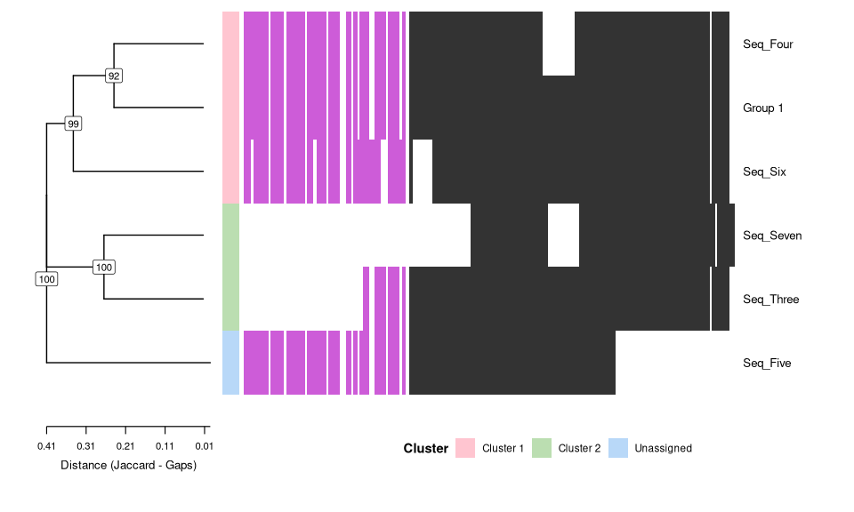

<!-- README.md is generated from README.Rmd. Please edit that file -->

# topo

<!-- badges: start -->

<!-- badges: end -->

**Evaluating gap and residue topologies in sequence alignments**

`topo` is an R package for clustering sequences based on the topology of
residues and/or gaps, i.e. it compares how distinct they are, allowing
researchers to get concrete metrics instead of just eyeballing
structural differences. It provides publication-ready figures that
combine a dendrogram, dynamic clusters, and sequence alignments into a
single plot.

It works by turning the alignment into a binary matrix and calculating
distances based on residue and/or gap positions. Then, it dynamically
clusters protein alignments, allowing more precision on unbalanced
datasets. It also supports bootstrapping, visual polytomy condensation,
and the highlighting of relevant regions within the alignment matrix.

## Installation

Because `topo` relies on the Bioconductor package `ggtree` for
phylogenetic visualization, you must install `ggtree` via `BiocManager`
before installing `topo`.

``` r
# 1. Install BiocManager if you don't have it
if (!requireNamespace("BiocManager", quietly = TRUE))
    install.packages("BiocManager")

# 2. Install ggtree from Bioconductor
BiocManager::install("ggtree")

# 3. Install topo from GitHub
# install.packages("devtools")
devtools::install_github("martimdfreitas/topo")
```

## Example

The package includes a synthetic dataset (`test.fasta`) to demonstrate
the use of the main visualization function (`topoplot`).

``` r
library(topo)

# Locate the bundled test dataset
fasta_path <- system.file("extdata", "test.fasta", package = "topo")

# Generate the complete plot
p <- topoplot(
  fasta_path = fasta_path,
  metric = "gaps",                  # Distance metrics: "gaps" (Jaccard), "residues" (Jaccard), or "both" (Hamming)
  bootstrap = 100,                  # Number of bootstrap iterations
  boot_threshold = 70,              # Collapses nodes with bootstrap support < 70 into polytomies
  highlight_regions = list(1:100),  # Structural domains to highlight in the matrix
  highlight_colors = c("#cd5cd8")   # Hex colors for the highlighted regions
)
#> Running bootstraps:       100 / 100
#> Calculating bootstrap values... done.

# Render the plot
p
```



### Retrieving Groups

The `topoclust` function can be used to retrieve information regarding
the members of each identified cluster, as well as to map which groups
the duplicated sequences belong to.

``` r
# Extract the cluster mapping dataframe
set.seed(12345)
cluster_data <- topoclust(
  fasta_path = fasta_path, 
  metric = "gaps"
)

# View the first few sequence assignments
head(cluster_data)
#>   Original_Sequence Assigned_Group    Cluster
#> 1           Seq_One        Group 1  Cluster 1
#> 2           Seq_Two        Group 1  Cluster 1
#> 3         Seq_Three      Seq_Three  Cluster 2
#> 4          Seq_Four       Seq_Four  Cluster 1
#> 5          Seq_Five       Seq_Five Unassigned
#> 6           Seq_Six        Seq_Six  Cluster 1
```
